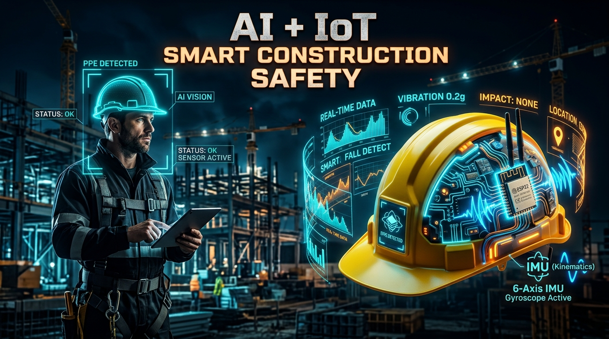

<div align="center">

# 🦺 Smart Safety Construction Site Monitor
### Real-Time YOLO AI PPE Compliance Detection + ESP32 IoT Smart Wearable Helmet

[](https://youtu.be/RTOscc7tufk "Click to Watch the Full Video on YouTube")

<p align="center">
  <a href="https://youtu.be/RTOscc7tufk" target="_blank">
    
  </a>
  
  
  
  
  
</p>

> **An enterprise cyber-physical safety intelligence platform integrating deep learning edge computer vision with real-time IoT wearable digital twin telemetry for industrial construction sites.**

</div>

---

## 📺 Demonstration Video & Highlights

Click the thumbnail banner above or the link below to watch the complete end-to-end demonstration video:

▶️ **[Watch the Live Demonstration on YouTube](https://youtu.be/RTOscc7tufk)**

<div align="center">
  <a href="https://youtu.be/RTOscc7tufk" target="_blank">
    
  </a>
  <br>
  <em>(Click above to open the video on YouTube)</em>
</div>

---

## 🚀 Key System Features

### 1. 👁️ Real-Time AI Computer Vision (PPE Inspection)
* **Custom YOLO Model**: Continuous non-intrusive surveillance auditing compliance across 13 classes:
  * **Compliant Gear**: `HELMET`, `VEST`, `GOGGLES`, `MASK`, `GLOVES`, `BOOTS`, `PERSON`
  * **Non-Compliance Violations**: `NO-HELMET`, `NO-VEST`, `NO-GOGGLE`, `NO-MASK`, `NO-GLOVES`, `NO-BOOTS`
* **Dynamic Hyperparameter Tuning**: Adjust confidence and IoU thresholds live from the dashboard.
* **Multi-Camera Engine**: Simultaneous ingestion across PC webcams, USB cameras, and wireless RTSP/WiFi streams.

### 2. 👤 Asynchronous Facial Recognition & Identity Attribution
* **InsightFace Biometrics**: Background vector extraction identifying registered personnel (e.g. *Jayasurya K*).
* **Automated Violation Logs**: Safety alerts directly tag violator name, department, ID, and roll number.
* **Multi-Angle Worker Enrollment**: Register new workers via 6 facial perspectives (*Front, Head Up, Head Down, Right, Left, Tilt*) for robust field recognition.

### 3. 👷 ESP32 Smart Helmet IoT Wearable
* **6-DoF Kinematics (MPU-6050)**: Tracks worker head tilt, pitch, roll, and abrupt g-force spikes for fall detection.
* **Toxic Gas Detection (MQ-7)**: Monitors harmful Carbon Monoxide levels.
* **Environmental Vitals (DHT-22)**: Reads real-time ambient temperature and humidity for heat-stress monitoring.
* **Emergency SOS Button**: Worker-triggered emergency switch for immediate site distress calls.

### 4. 🌐 3D Digital Twin & Cloud Dashboard
* **Three.js Interactive Viewer**: Real-time 3D spatial orientation mirroring the physical hardhat.
* **Firebase Realtime Database (RTDB)**: Low-latency cloud telemetry synchronization between wearable nodes and web clients.
* **Automated Alert Dispatch**: 5-second cooldown protection, acknowledgment workflows, and hardware serial triggers for physical siren base stations.

---

## 🏗️ Repository Architecture

```
Smart-Safety-Monitor/
├── backend/
│   ├── app/
│   │   ├── routers/       # FastAPI REST & WebSocket endpoints (cameras, alerts, events, workers)
│   │   ├── services/      # YOLO inference engine, camera streaming & serial communications
│   │   └── models/        # SQLite database schemas and Pydantic models
│   ├── face/              # InsightFace biometrics engine & embedding generator
│   └── requirements.txt   # Python backend dependencies
├── frontend/
│   ├── src/
│   │   ├── pages/         # Dashboard views (Overview, LiveMonitoring, HelmetIoT, SafetyAlerts, Workers)
│   │   ├── components/    # Reusable UI widgets & Three.js Helmet3DViewer
│   │   ├── hooks/         # Custom hooks (useHelmetTelemetry for Firebase RTDB)
│   │   └── services/      # REST API & WebSocket clients
│   └── package.json       # React, Vite, TailwindCSS & Three.js dependencies
├── esp32/
│   ├── esp32_ppe_alert.ino                 # Hardware alarm base station firmware (buzzer + strobe)
│   └── construction_safety_wifimanager.ino # Smart helmet wearable firmware (sensors + WiFiManager)
├── start_system.bat       # Windows 1-click batch launcher
├── start_system.ps1       # Windows 1-click PowerShell launcher
├── Dockerfile             # Multi-stage production container build
├── youtube_thumbnail.png  # Video demonstration thumbnail
└── README.md
```

---

## 🔥 Firebase Setup Steps (Realtime Database & Authentication)

The Smart Safety Helmet streams live telemetry (IMU kinematics, DHT-22 climate data, MQ-7 gas levels, and SOS status) directly to the cloud via **Firebase Realtime Database (RTDB)**. Follow these steps to configure your own Firebase project:

### Step 1: Create a Firebase Project
1. Go to the [Firebase Console](https://console.firebase.google.com/).
2. Click **Add Project**, enter a project name (e.g. `smart-safety-monitor`), and complete project creation.

### Step 2: Enable Email/Password Authentication
1. In the Firebase console sidebar, navigate to **Build > Authentication**.
2. Click **Get Started**, choose the **Sign-in method** tab, and enable **Email/Password**.
3. Switch to the **Users** tab and click **Add user**:
   * **Email**: e.g. `worker@smart-safety.com`
   * **Password**: enter a strong password (minimum 6 characters).
   *(Keep these credentials handy for both the frontend and the ESP32 node).*

### Step 3: Create the Realtime Database
1. In the sidebar, navigate to **Build > Realtime Database** and click **Create Database**.
2. Select your geographic region and click **Next**.
3. In the **Rules** tab, set authenticated read/write access:
   ```json
   {
     "rules": {
       "sensors": {
         ".read": "auth != null",
         ".write": "auth != null"
       }
     }
   }
   ```
4. Note your **Database URL** from the header (e.g. `https://your-project-id-default-rtdb.firebaseio.com/`).

### Step 4: Retrieve the Web API Key
1. Click the **Project settings** gear icon (top left) > **General**.
2. Under *Project overview*, copy your **Web API Key** (`AIzaSy...`).

---

### Step 5: Configure Environment Secrets

#### A. Frontend Configuration
1. In the `frontend/` directory, copy `.env.example` to create your local `.env`:
   ```bash
   cd frontend
   cp .env.example .env
   ```
2. Populate `.env` with your Firebase credentials:
   ```env
   VITE_FIREBASE_API_KEY=AIzaSyYourApiKeyHere
   VITE_FIREBASE_DATABASE_URL=https://your-project-id-default-rtdb.firebaseio.com
   VITE_FIREBASE_AUTH_EMAIL=worker@smart-safety.com
   VITE_FIREBASE_AUTH_PASSWORD=your_password_here
   ```
   *(Note: `frontend/.env` is strictly ignored by Git to safeguard your credentials).*

#### B. ESP32 Hardware Firmware Configuration
1. In `esp32/advance_level/`, copy `secrets.h.example` to `secrets.h`:
   ```bash
   cd esp32/advance_level
   cp secrets.h.example secrets.h
   ```
2. Fill in your matching Firebase credentials:
   ```cpp
   #define API_KEY        "AIzaSyYourApiKeyHere"
   #define DATABASE_URL   "https://your-project-id-default-rtdb.firebaseio.com"
   #define USER_EMAIL     "worker@smart-safety.com"
   #define USER_PASSWORD  "your_password_here"
   #define AP_PASSWORD    "12345678" // WiFi hotspot portal password
   ```
   *(Note: `secrets.h` is strictly ignored by Git to prevent private key exposure).*

---

## ⚡ Quick Start & Installation

### Option A: One-Click Startup (Windows)
Double-click either launcher script in the root directory:
* **`start_system.bat`** OR
* **`start_system.ps1`**

This will automatically launch both the FastAPI backend (`http://localhost:8000`) and Vite frontend (`http://localhost:5173`).

---

### Option B: Manual Setup

#### 1. Backend (FastAPI & Computer Vision)
```bash
# Navigate to backend
cd backend

# Create & activate virtual environment
python -m venv .venv
.venv\Scripts\activate      # On Windows
# source .venv/bin/activate  # On Linux/macOS

# Install dependencies
pip install -r requirements.txt

# Start backend server
uvicorn app.main:app --host 0.0.0.0 --port 8000 --reload
```

#### 2. Frontend (React + Vite + Three.js)
```bash
# Navigate to frontend
cd frontend

# Install packages
npm install

# Start development dashboard
npm run dev
```
Open **`http://localhost:5173`** in your browser.

---

## 🔌 Hardware Setup (ESP32)

1. **Smart Helmet Wearable**:
   * Open `esp32/advance_level/construction_safety_wifimanager/construction_safety_wifimanager.ino` in Arduino IDE.
   * Wire the **MPU-6050** (I2C: SDA 21, SCL 22), **DHT-22** (Pin 4), **MQ-7** (Pin 34), and **SOS Button** (Pin 16).
   * Flash to the ESP32 and configure WiFi via captive portal.
2. **Alarm Base Station**:
   * Open `esp32/esp32_ppe_alert.ino`.
   * Connect buzzer (Pin 25) and LED strobe (Pin 26).
   * Connect via USB and set COM port in the dashboard Settings.

---

## 📄 License & Credits
Developed for **Smart Construction Site Safety Monitoring**.  
Powered by **YOLO**, **InsightFace**, **FastAPI**, **Three.js**, and **ESP32**.
